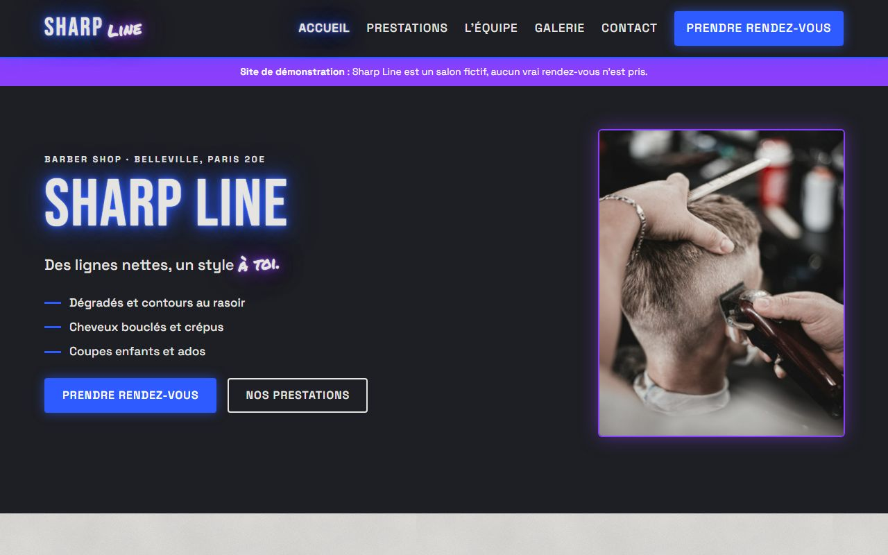
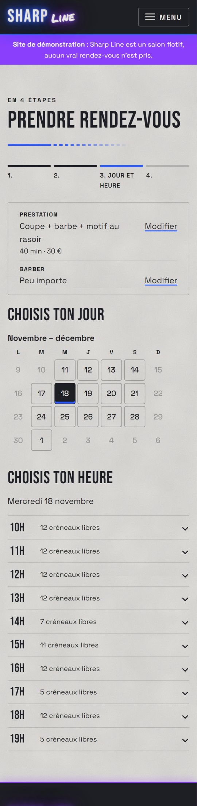
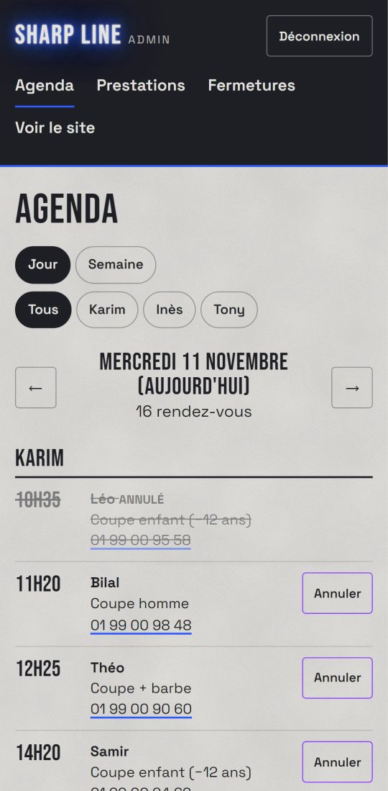
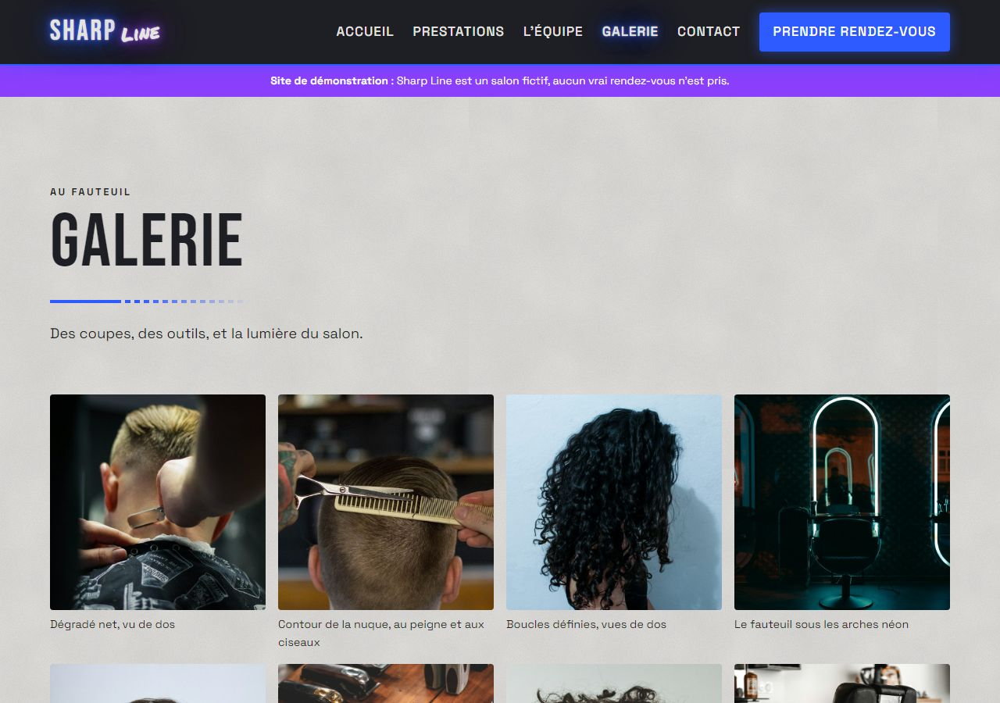
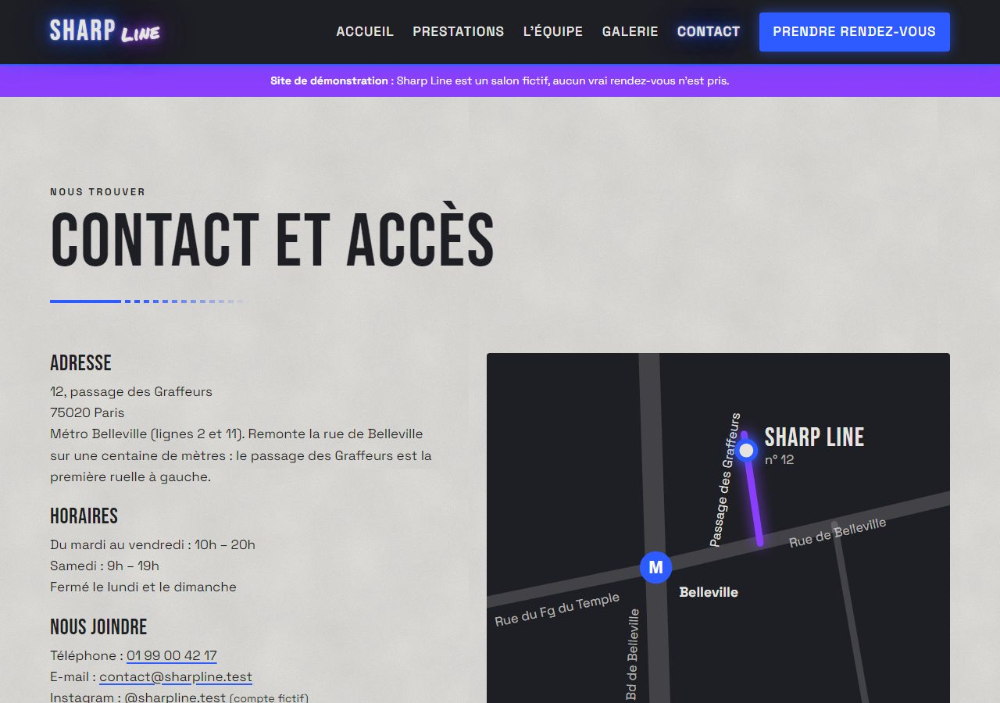

# Sharp Line

**Site vitrine d'un barber shop parisien fictif, avec prise de rendez-vous en ligne et tableau de bord.**
PHP 8 et MySQL, sans framework · Projet de portfolio de Ricardo Remond

**[Voir le site en ligne →](https://sharpline.alwaysdata.net)**

> « Des lignes nettes, un style à toi. »
> Barber shop urbain à Belleville (Paris 20e) : Karim, Inès et Tony, dégradés au rasoir,
> cheveux bouclés et crépus, coupes enfants. Les personnes, l'adresse et le téléphone sont inventés.



| Prise de rendez-vous (mobile) | Agenda du tableau de bord (mobile) |
|---|---|
|  |  |

| Galerie | Contact et plan d'accès en SVG |
|---|---|
|  |  |

---

## Ce que fait le site

- **Une identité urbaine** : béton clair, blocs anthracite où brillent des néons bleu et violet,
  quatre couleurs en variables CSS et trois éléments graphiques seulement (texture béton, néon, tag).
  La texture béton est un bruit SVG généré par le navigateur (moins de 1 Ko), les néons sont en CSS pur.
- **La prise de rendez-vous en 4 étapes** : prestation (+ motif au rasoir), barber ou « peu importe »,
  jour dans un mini-calendrier, puis créneau parmi les heures repliables, et enfin prénom + téléphone.
  - créneaux de 5 minutes calculés selon la durée, les horaires, les fermetures et l'agenda du barber ;
  - 5 minutes de battement après chaque client (nettoyer, encaisser), arrondi à la dizaine,
    invisibles pour le client ;
  - « peu importe » attribue le barber le moins chargé du jour ;
  - chaque choix est un bouton : tout fonctionne **sans JavaScript**.
- **Prestations, équipe et horaires viennent de MySQL**, galerie avec agrandissement (`<dialog>`),
  plan d'accès dessiné en SVG (aucun service de carte, donc aucun cookie).
- **Un tableau de bord pensé pour le téléphone** : agenda du jour ou de la semaine par barber,
  annulation, prix et durées des prestations, blocage d'un jour pour le salon ou un barber.

## Choix techniques

- **PHP 8 et MySQL sans framework** : includes réutilisables, PDO avec de vraies requêtes préparées,
  tout le SQL d'un usage regroupé dans un seul fichier.
- **HTML sémantique, CSS et JavaScript natifs**, mobile en priorité. Le JavaScript se limite
  à deux petits fichiers de confort (menu mobile, agrandissement de la galerie).
- **Le site public ne dépose aucun cookie** : pas de bandeau de consentement, polices hébergées
  sur le site.
- **Pas de dépendance** : ni Composer, ni npm, ni outil d'assemblage.

## Sécurité

- **Requêtes préparées** partout, **échappement** systématique à l'affichage (`e()`),
  **politique de sécurité du contenu (CSP)** stricte : aucun script, style ou police extérieur.
- **Rendez-vous sans cookie** : champ piège invisible, jeton signé (HMAC) contenant l'heure
  d'affichage (accepté entre 3 s et 2 h), 2 rendez-vous à venir par numéro, 20 par heure pour le site.
- **Pas de double réservation** : l'enregistrement verrouille les barbers concernés
  (`SELECT … FOR UPDATE`) puis revérifie le créneau.
- **Confirmation signée** : changer le numéro dans l'adresse ne montre pas le rendez-vous d'un autre.
- **Tableau de bord** :
  - mots de passe hachés (`password_hash`), comptes créés en ligne de commande, sans page d'inscription ;
  - cookie de session limité à `/admin/`, `HttpOnly`, `SameSite=Strict`, `Secure` en ligne ;
  - identifiant de session renouvelé à la connexion, déconnexion après 2 h d'inactivité,
    session coupée si le compte est supprimé ;
  - jeton CSRF sur chaque action, connexion et déconnexion comprises ;
  - blocage de 15 minutes après 5 échecs, comptés par MySQL.
- **En ligne** : HTTPS forcé, en-têtes de sécurité, dossiers internes inaccessibles (404),
  erreurs PHP jamais affichées (page 503 sobre si la base ne répond pas), secrets uniquement sur le serveur.
- **RGPD** : seulement le prénom et le téléphone, pas d'adresse IP ; rendez-vous supprimés
  automatiquement un mois après leur date.

## Qualité vérifiée

| Contrôle | Résultat |
|---|---|
| Lighthouse mobile (accueil) | 100 en performance, accessibilité, bonnes pratiques et SEO |
| Validateur HTML (validator.nu, 9 pages) | aucune erreur réelle (seuls avertissements : `role="list"`, voulu pour Safari) |
| `tests/securite.php` (en ligne) | 36 vérifications : pages sans cookie, en-têtes, dossiers internes, CSRF, session, blocage, HTTPS |
| `tests/rendez-vous.php` | 37 vérifications : créneaux, battement, jeton, coordonnées, double réservation en base |

## Démarche

Le projet a avancé en huit phases, chacune validée avant de passer à la suivante :
fondations, composants, pages statiques, base de données, prise de rendez-vous, finitions,
tableau de bord, puis mise en ligne. L'historique Git suit ces étapes.

---

## Installer le projet en local

**Prérequis** : [Laragon](https://laragon.org/) (Apache, PHP 8.1+, MySQL), ou tout serveur
Apache avec PHP 8.1+ (extensions `intl`, `mbstring`, `pdo_mysql`, `gd`) et MySQL ou MariaDB.

1. Placer le projet dans `C:\laragon\www\sharp-line`, puis cliquer sur **Recharger** dans Laragon :
   le site est servi sur `http://sharp-line.test`.
2. Base de données, en `root` :
   - mettre un mot de passe à la place de `CHANGER_CE_MOT_DE_PASSE` dans `sql/creation-base.sql`,
     puis exécuter ce fichier (base et utilisateur dédié) ;
   - exécuter `sql/schema.sql` puis `sql/seed.sql`.
3. Copier `config/config.example.php` en `config/config.local.php` et y mettre l'adresse du site,
   le même mot de passe et une clé secrète aléatoire (`php -r "echo bin2hex(random_bytes(32));"`).
   Ce fichier est exclu de Git.
4. Créer un compte pour le tableau de bord (`/admin/`) : `php outils/creer-admin.php karim`.
5. Facultatif, un agenda de démonstration sur 7 jours : `php outils/remplir-demo.php`
   (`--vider` pour le retirer).

**Attention** : `sql/schema.sql` supprime toutes les tables, comptes et rendez-vous compris.
Ne jamais le lancer sur le site en ligne.

**Tests**, MySQL démarré : `php tests/rendez-vous.php` et `php tests/securite.php`

## Structure

```
sharp-line/
├── *.php          pages publiques (accueil, prestations, équipe, galerie, rendez-vous, contact…)
├── admin/         tableau de bord
├── includes/      morceaux de page, connexion, rendez-vous, formulaires, données, admin
├── config/        configuration (site.php versionné ; config.local.php exclu de Git)
├── sql/           création de la base, tables, données de départ
├── outils/        scripts en ligne de commande (comptes, agenda de démonstration)
├── tests/         tests en ligne de commande
└── assets/        CSS, JavaScript, polices (.woff2 et licences), images
```

## Mise en ligne (alwaysdata)

Le code est envoyé par Git en SSH dans un dépôt nu (`~/depot.git`), puis déposé dans `~/www`.
`config/config.local.php` n'existe que sur le serveur. Pour publier une mise à jour :

```
git push ssh://sharpline@ssh-sharpline.alwaysdata.net/home/sharpline/depot.git main
ssh sharpline@ssh-sharpline.alwaysdata.net "git --git-dir=depot.git --work-tree=www checkout -f main"
```

## Crédits

- Polices : Bebas Neue et Space Grotesk (SIL Open Font License 1.1), Permanent Marker (Apache 2.0) ;
  textes des licences dans `assets/fonts/licences/`.
- Photographies sous [licence Unsplash](https://unsplash.com/license) : Tá Focando, Jonathan Cooper,
  Zlobniyy, Sinval Carvalho, Chris Knight, Ursula Castillo, Emanuel Haas, George Huffman,
  Agustin Fernandez, Tamas Pap, Caio Coelho, Josh Sorenson, YearOne, František Čaník, Bappie
  (liens vers chaque photo dans les mentions légales du site).
